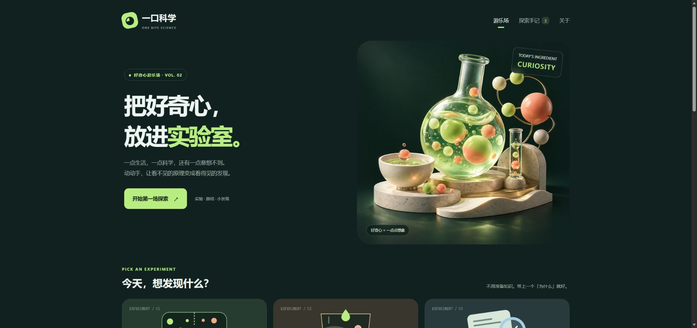

# 一口科学 · One Bite Science

给好奇心的互动游乐场：用小实验、小游戏和一分钟科普，练习观察、比较与判断。



## 开始使用

下载本仓库的 ZIP 并解压，网站入口是 [`dist/index.html`](dist/index.html)。也可以在仓库根目录运行：

```sh
python -m http.server 8000 --directory dist
```

然后在浏览器打开 `http://localhost:8000`。网站不需要账号、构建步骤或外部代码依赖。完整流程已在本地 HTTP 服务下试玩；直接双击本地文件的兼容性未完整验证，部分浏览器可能限制本地字幕或记录保存。

## 可以玩什么

| 内容 | 入口与玩法 |
| --- | --- |
| 分子漫游、乳化工坊、证据侦探 | [首页](dist/index.html)：三项科学互动，完成探索可收集徽章 |
| 微观快递 | [八关小游戏](dist/arcade.html)：练习或限时挑战，支持键盘和屏幕按钮 |
| 关卡工坊 | [自己画迷宫](dist/builder.html)：编辑、撤销、路线检查、试玩、JSON 导入导出 |
| 数据放大镜 | [三个数据实验](dist/data-lab.html)：纵轴、均值与中位数、抽样波动 |
| 实验设计工作台 | [四个设计情境](dist/design-lab.html)：选择变量、对照、重复与指标，生成设计卡 |
| 科普放映室 | [三集短片](dist/video.html)：每集 60 秒，中文字幕与普通话合成旁白 |
| 分子运动互动短片 | [可拖动动画](dist/film.html)：可暂停、回看和跳章节，无音轨 |
| 口袋知识卡 | [30 张知识卡](dist/cards.html)：分类、收藏、洗牌和答题 |
| 中文探究手册 | [12 页 PDF](dist/assets/exploration-handbook.pdf)：练习、答案和手写记录表 |

GitHub 文件页面展示源码；运行网页请下载后使用上面的本地服务方式。

## 视频文件

三集均有横屏 1920×1080 和竖屏 1080×1920 两版，60 秒、30fps、H.264/AAC。

| 主题 | 横屏 | 手机竖屏 |
| --- | --- | --- |
| 看起来翻倍，真的翻倍了吗？ | [MP4](dist/assets/chart-illusion.mp4) | [MP4](dist/assets/chart-illusion-portrait.mp4) |
| 平均数藏起了什么？ | [MP4](dist/assets/average-hidden.mp4) | [MP4](dist/assets/average-hidden-portrait.mp4) |
| 抛十次硬币，为什么不一定五次正面？ | [MP4](dist/assets/coin-variation.mp4) | [MP4](dist/assets/coin-variation-portrait.mp4) |

画面已内嵌中文字幕；网页提供完整旁白稿、VTT 字幕与资料链接。

## 内容边界与本地记录

- 科学图形与动画是简化教学模型，数值和研究情境均为虚构或明确标注的模拟，不是实际实验测量、工艺预测或食用建议。
- 微观快递与关卡工坊是纯虚构益智游戏，不模拟真实分子运输。徽章、通关与设计反馈不是专业能力认证。
- 视频和互动页采用不同的随机生成与分组规则；固定编号仅在各自模块内复现，不保证跨模块结果相同。
- 进度、收藏、地图草稿和笔记保存在当前浏览器；页面代码不上传这些记录。清除网站数据或更换浏览器可能丢失记录，重要内容可自行导出。
- 教学模块提供教材和机构资料入口。内容由 AI 辅助制作，经过来源核对、独立复核、针对性逻辑检查和浏览器试玩；未开展教学效果验证。

## 项目结构

```text
dist/       完整静态网站、六个视频及 PDF 手册
docs/       网站预览
scripts/    静态资源与知识卡完整性检查
```

运行 `python scripts/check_release.py` 可核对本地网页引用与知识卡数据。首页两张装饰插画由图像生成工具制作；游戏与科学图形由程序绘制。仓库不包含本机字体文件、个人工作记录或私有部署配置。
